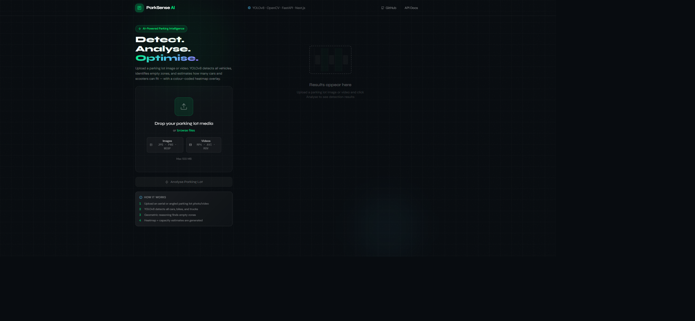
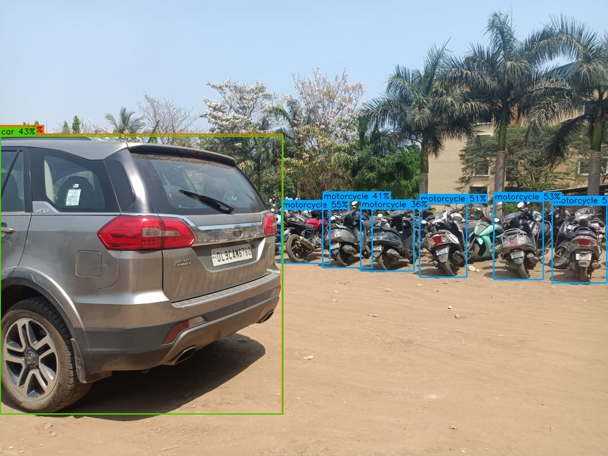
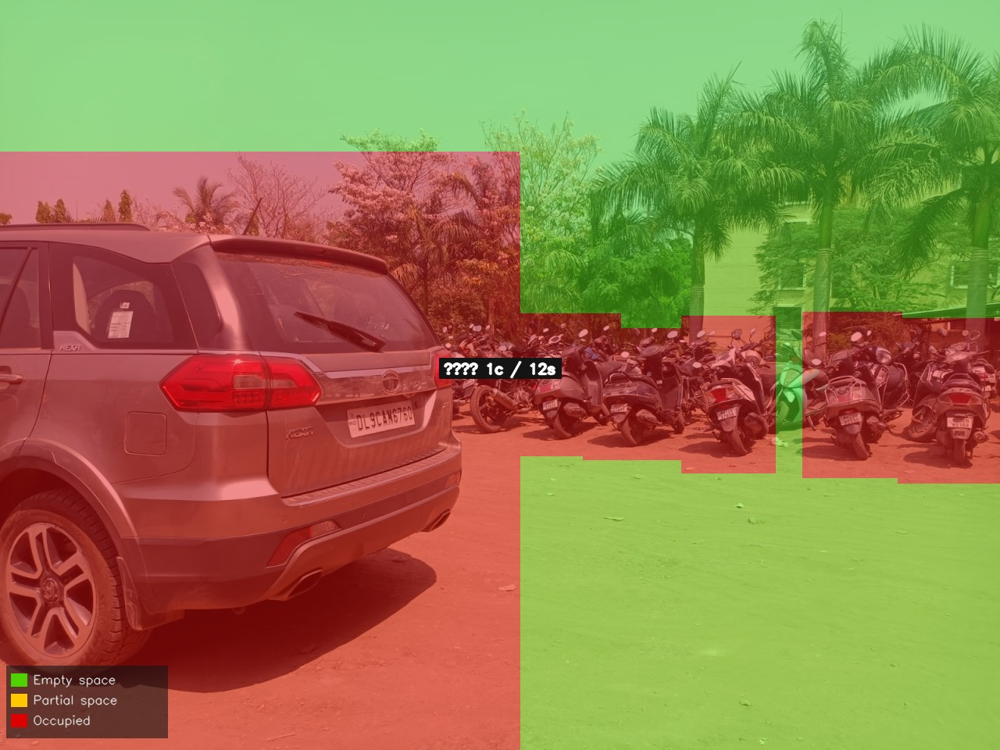

# 🅿️ ParkSense AI — Smart Parking Detection System

[](https://www.python.org/)
[](https://fastapi.tiangolo.com/)
[](https://nextjs.org/)
[](https://ultralytics.com/)
[](https://frontend-six-steel-948mxn5ji1.vercel.app)
[](LICENSE)
[](https://github.com/harshvshah12)

> 🌐 **Live Web Application:** [frontend-six-steel-948mxn5ji1.vercel.app](https://frontend-six-steel-948mxn5ji1.vercel.app)  
> AI-powered parking lot analysis using **YOLOv8** + **OpenCV** + **FastAPI** + **Next.js 14** + **Tailwind CSS**

---

## 📸 Playwright Verification & Dashboard Previews

### 1. Next.js 14 Bento Dashboard (Playwright Capture)
*Production dark-slate UI (`#0D1117`) with drag-and-drop media uploader, dynamic progress indicators, and status metrics.*



---

### 2. YOLOv8 Vehicle Detection & Spatial Heatmap Engine
*Side-by-side detection bounding boxes and connected-component spatial occupancy heatmap.*

| YOLOv8 Object Detection & Bounding Boxes | OpenCV Spatial Density Heatmap Overlay |
| :---: | :---: |
|  |  |

---

## 🎯 What It Does

Upload a photo or video of any parking lot and ParkSense AI will:

| Feature | Detail |
|---|---|
| 🚗 **Vehicle Detection** | YOLOv8 detects cars, motorcycles, trucks, and buses with confidence scoring |
| 🟢 **Empty Space Identification** | Connected-component analysis on the continuous occupancy grid |
| 🌡️ **Heatmap Overlay** | Dynamic OpenCV spatial density heatmap: Green = empty · Yellow = partial · Red = occupied |
| 📐 **Geometric Capacity Estimation** | Area calibration with perspective foreshortening correction → predicts remaining cars & scooters capacity |
| 📹 **Video Support** | Dynamic frame sampling + temporal aggregation for stable video metrics |
| 📊 **Modern Bento Dashboard** | Next.js 14 UI with drag-and-drop, real-time polling, and interactive Recharts timeline |

---

## 🏗️ Architecture

```
┌─────────────────────────────────────────────────────────────────────┐
│                         ParkSense AI Stack                          │
├──────────────────┬──────────────────────┬───────────────────────────┤
│  Next.js 14      │   FastAPI (Python)   │    AI / CV Layer          │
│  Tailwind CSS    │   Uvicorn server     │    YOLOv8 (ultralytics)   │
│  Framer Motion   │   Background tasks   │    OpenCV image proc      │
│  Recharts        │   Static file serve  │    NumPy geometry         │
│  react-dropzone  │   CORS middleware    │    Heatmap generation     │
└──────────────────┴──────────────────────┴───────────────────────────┘
```

### Request & Processing Flow

```
User Upload (Photo / Video) 
       │
       ▼
POST /upload ───────────────────► Generates UUID Job ID & Queues Background Task
       │                                     │
       │                                     ▼
       │                          [ ParkingDetector (YOLOv8) ]
       │                          - Bounding boxes for cars, buses, bikes
       │                                     │
       │                                     ▼
       │                          [ SpaceEstimator (Geometry) ]
       │                          - Bounding box dilation & occupancy grid
       │                          - Perspective compensation scaling
       │                                     │
       │                                     ▼
       │                          [ HeatmapGenerator (OpenCV) ]
       │                          - Gaussian blur & color-mapped spatial gradient
       │                                     │
       │                                     ▼
       │                          [ Static Disk Output & In-Memory Store ]
       ▼                                     │
GET /analyze/{job_id} ◄──────────────────────┘
(Polls until progress = 100%)
       │
       ▼
UI Renders Annotated View, Spatial Heatmap, and Real-Time Bento Capacity Gauges
```

---

## 🚀 Quick Start

### Option A — Docker Compose (Recommended)

```bash
git clone https://github.com/harshvshah12/ParkSense-AI.git
cd ParkSense-AI
docker compose up --build
```

- **Frontend Dashboard:** http://localhost:3000
- **Backend API:** http://localhost:8000
- **Interactive Swagger Docs:** http://localhost:8000/docs

> **Note:** On first startup, the backend automatically downloads the lightweight YOLOv8 nano model (`yolov8n.pt`, ~6 MB).

---

### Option B — Local Manual Setup

#### 1. Backend (FastAPI + YOLOv8)

```bash
cd backend

# Create and activate virtual environment
python -m venv .venv

# Windows
.\.venv\Scripts\activate
# Linux/macOS
source .venv/bin/activate

# Install dependencies
pip install -r requirements.txt

# Start backend development server
uvicorn main:app --reload --port 8000
```

The API will be live at `http://localhost:8000`. Test endpoints via `http://localhost:8000/docs`.

#### 2. Frontend (Next.js 14 + Tailwind CSS)

```bash
cd frontend

# Install node dependencies
npm install

# Start Next.js development server
npm run dev
```

Open [http://localhost:3000](http://localhost:3000) in your browser.

#### 3. Test with Sample Data

A pre-configured test image `sample_parking_lot.png` is provided in the repository root. Drag and drop it directly into the frontend upload zone to immediately verify the detection pipeline, occupancy ratio, and heatmap overlay!

---

## 📁 Project Structure

```
parksense-ai/
├── backend/
│   ├── main.py                 # FastAPI app, endpoints, lifespan
│   ├── models/
│   │   ├── detector.py         # YOLOv8 vehicle detector wrapper
│   │   └── space_estimator.py  # Geometric capacity estimation
│   ├── utils/
│   │   ├── image_processor.py  # Single-frame pipeline
│   │   ├── video_processor.py  # Frame-sampling video pipeline
│   │   └── heatmap.py          # OpenCV heatmap generator
│   ├── routers/
│   │   └── results.py          # Historical results endpoints
│   ├── requirements.txt
│   └── Dockerfile
├── frontend/
│   ├── src/
│   │   ├── app/
│   │   │   ├── page.tsx        # Main dashboard page
│   │   │   ├── layout.tsx      # Root layout + fonts
│   │   │   └── globals.css     # Base styles + CSS utilities
│   │   ├── components/
│   │   │   ├── Header.tsx
│   │   │   ├── UploadZone.tsx  # Drag & drop upload
│   │   │   ├── ProcessingIndicator.tsx
│   │   │   ├── ResultsPanel.tsx # Image viewer + toggle
│   │   │   ├── StatsCards.tsx  # Metric cards
│   │   │   └── OccupancyChart.tsx # Timeline recharts
│   │   ├── lib/
│   │   │   ├── api.ts          # Typed API client
│   │   │   └── utils.ts        # cn() helper
│   │   └── types/
│   │       └── api.ts          # TypeScript interfaces
│   ├── package.json
│   ├── tailwind.config.js
│   └── Dockerfile
└── docker-compose.yml
```

---

## 🔌 API Reference

### POST `/upload`
Upload an image or video.

```json
// Response
{ "job_id": "uuid", "status": "queued", "media_type": "image" }
```

### GET `/analyze/{job_id}`
Poll job status and retrieve results.

```json
// Response (completed)
{
  "job_id": "...",
  "status": "completed",
  "progress": 100,
  "result": {
    "vehicles": { "cars": 12, "bikes": 3, "total": 15 },
    "empty_spaces": 4,
    "occupancy_ratio": 0.65,
    "estimated_capacity": { "cars": 8, "scooters": 42 },
    "annotated_media_url": "/outputs/annotated/uuid_annotated.jpg",
    "heatmap_url": "/outputs/heatmaps/uuid_heatmap.jpg",
    "annotated_b64": "...",
    "heatmap_b64": "..."
  }
}
```

### GET `/health`
Health check.

---

## ⚙️ Configuration

| Variable | Default | Description |
|---|---|---|
| `YOLO_MODEL_SIZE` | `n` | `n/s/m/l/x` — larger = more accurate but slower |
| `CONF_THRESHOLD` | `0.35` | Detection confidence threshold |
| `FRAME_INTERVAL` | `1.0` | Seconds between video frames analysed |
| `MAX_FILE_SIZE` | `100 MB` | Upload size limit |
| `NEXT_PUBLIC_API_URL` | `http://localhost:8000` | Backend URL for frontend |

---

## 🧠 Space Estimation Logic

1. **Calibration** — Median car bounding box area → pixels per m²
2. **Occupancy Grid** — Boolean H×W mask from dilated bounding boxes
3. **Free Regions** — Connected-component analysis (8-connectivity) with morphological opening to remove noise
4. **Perspective Scaling** — Regions near the top of the frame (farther away) are scaled up to account for foreshortening
5. **Packing Estimate** — `real_area_m² × packing_efficiency / vehicle_size_m²`

| Vehicle | Real Size | Packing Efficiency |
|---|---|---|
| Car | 4.8m × 2.0m = 9.6 m² | 70% |
| Scooter | 1.8m × 0.8m = 1.44 m² | 80% |

---

## 🚀 Production Deployment Tips

- **GPU**: Install `torch` with CUDA and set `device='cuda'` in `ParkingDetector` for 10-50× speedup
- **Model size**: Use `yolov8s` or `yolov8m` for better accuracy on complex lots
- **Workers**: Use Gunicorn + Uvicorn workers for multi-core CPU inference
- **Storage**: Replace in-memory job store with Redis; move outputs to S3/GCS
- **Auth**: Add API key middleware for production access control

---

## 📄 License

MIT — Free for commercial and personal use.
